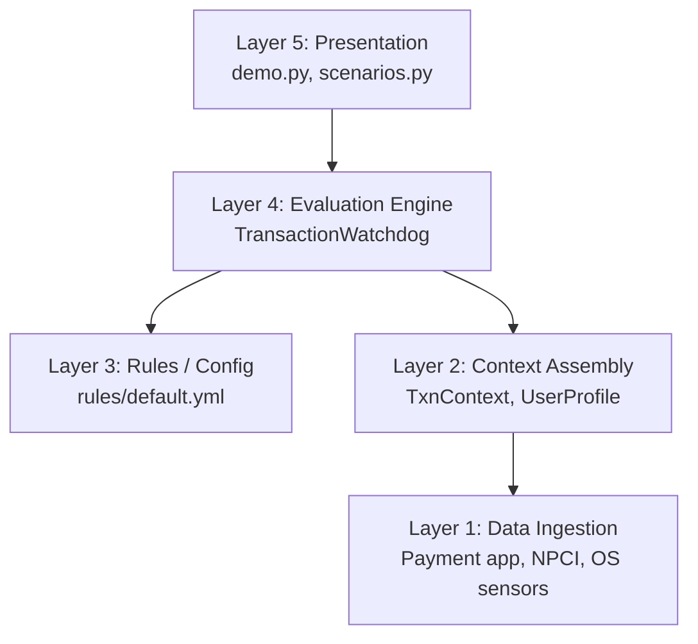
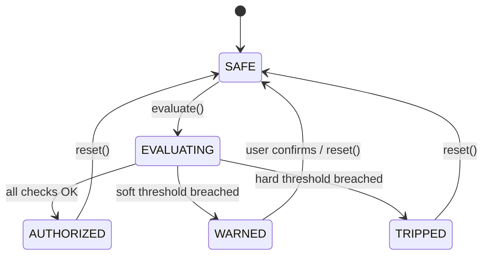

# Architecture (Internal Software)

This document describes the **internal software layers** of the watchdog.
The system-level deployment view (TEE, NPCI Switch, UPI Protocol) is in [README.md](README.md).


## Overview

UPI Fraud-Watchdog is a PLC-inspired fail-safe gate.
All layers are synchronous, single-threaded, and stateful per evaluation cycle.



## Layer 1: Data Ingestion

| Input | Source | Format |
|-------|--------|--------|
| Action events | Payment app foreground log | `[(action, timestamp), ...]` |
| UPI payload | NPCI / PSP API | VPA, amount, txn ref, MCC |
| Device signals | OS sensors | `screen_on`, `touch_active`, `no_overlay` |
| Linked transactions | Internal ledger | `[(vpa, receipt_sec, forward_sec), ...]` |
| User profile | Offline ML (future) | `normal_hours`, `max_txn_per_hour`, `trusted_vpAs` |

> See `data_sources.md` for trust levels and failure modes.

## Layer 2: Context Assembly

**`TxnContext`** — the single struct the watchdog consumes.

| Field | Type | Source |
|-------|------|--------|
| `now` | `datetime` | Last event timestamp |
| `last_txn_time` | `Optional[datetime]` | Previous confirmed txn |
| `last_scam_alert_time` | `Optional[datetime]` | Scam detection module |
| `events` | `List[Tuple[str, datetime]]` | Action sequence |
| `screen_on` | `bool` | OS sensor |
| `touch_active` | `bool` | OS sensor |
| `no_overlay` | `bool` | OS sensor |
| `target_vpa` | `str` | UPI payload |
| `txn_count_this_hour` | `int` | Internal counter |
| `linked_txns` | `Optional[List[Tuple[str, float, float]]]` | Ledger |

**`UserProfile`** — learned normalcy (Phase 5+).

| Field | Type | Default |
|-------|------|---------|
| `normal_hours` | `set[int]` | `{8..21}` |
| `max_txn_per_hour` | `int` | `5` |
| `trusted_vpAs` | `set[str]` | `∅` |

## Layer 3: Rules / Configuration

**File:** `rules/default.yml`

| Section | Keys | Purpose |
|---------|------|---------|
| `watchdog` | `min_seconds_between_txns`, `min_scam_proximity_sec`, `max_txn_per_hour`, `normal_hours`, `network_min_linked`, `network_forward_max_sec` | Global thresholds |
| `dwell_min` | `open_app`, `select_contact`, `enter_amount`, `verify`, `confirm` | Per-step minimum dwell (seconds) |
| `expected_sequence` | list of 5 actions | Required action order |

**Threshold summary:**

| Check | OK | ⚠ WARN | ✗ TRIP |
|-------|----|--------|--------|
| Velocity | Δt ≥ 30s | 20s ≤ Δt < 30s | Δt < 20s |
| Time of day | 8 ≤ h < 22 | 7 ≤ h < 23 | h < 7 or h ≥ 23 |
| Scam proximity | Δt ≥ 300s | 250s ≤ Δt < 300s | Δt < 250s |
| Txn count | ≤ 5 | 6 | > 6 |
| Network velocity | < 5 in 90s | ≥ 5 in 90s | ≥ 8 in 60s |
| Sequence/Dwell | correct | — | wrong |
| Heartbeat | all present | — | any lost |


**Loading:** `load_rules(path)` → `yaml.safe_load` → passed to `TransactionWatchdog.__init__`.

**Validation:** Corrupt values raise `ValueError` (covered by `fuzz_rules.py`).

## Layer 4: Evaluation Engine

**Class:** `TransactionWatchdog`

### State Machine



### Check Pipeline (AND-gated)

| # | Check | Trips on | Warns on |
|---|-------|----------|----------|
| 1 | Velocity | Δt < `trip_seconds_between_txns` | `trip` ≤ Δt < `min_seconds_between_txns` |
| 2 | Time of day | hour outside `trip_normal_hours` | hour outside `normal_hours` (but inside trip) |
| 3 | Scam proximity | Δt < `trip_scam_proximity_sec` | `trip` ≤ Δt < `min_scam_proximity_sec` |
| 4 | Txn count | count > `trip_max_txn_per_hour` | `max` < count ≤ `trip_max` |
| 5 | Sequence + Dwell | Wrong order OR dwell < min | — (binary) |
| 6 | Heartbeat | Any signal lost | — (binary) |
| 7 | Network velocity | ≥ `trip_network_min_linked` in `trip_forward` sec | ≥ `network_min_linked` in `forward_max` sec |


**Logic:** All 7 must pass → AUTHORIZED. Any hard failure → TRIPPED.
Any soft failure (no hard) → WARNED. All checks run (no short-circuit) → full fault report.


### Output

```python
evaluate(ctx) → (passed: bool, reason: str)
# AUTHORIZED:  passed=True,  "[ALL CHECKS] OK — Transaction authorized."
# WARNED:      passed=True,  "⚠️ WARNING: [CODE] detail — Authorized with caution."
# TRIPPED:     passed=False, "BLOCKED: [CODE] detail"

```

## Layer 5: Presentation

**File:** `demo.py`

- CLI: `python demo.py --scenario <key>` or bare (runs all 14)
- Prints per-check ✓/✗ table
- Verifies expected outcome + expected faults
- Resets watchdog after each scenario

## File Map

| File | Layer | Responsibility |
|------|-------|----------------|
| `demo.py` | 5 | CLI runner, display |
| `scenarios.py` | 5 | 14 test scenarios (dict) |
| `watchdog.py` | 4 | `TransactionWatchdog`, `TxnContext`, `UserProfile`, `load_rules` |
| `rules/default.yml` | 3 | Thresholds, dwell, sequence |
| `fuzz/` | 4 | Hypothesis fuzz suite (21 tests) |

## Design Decisions

| Decision | Rationale |
|----------|-----------|
| AND-gate (no short-circuit) | PLC fault-summary pattern — report ALL faults, not just first |
| State machine (not just return) | Supports sticky-trip, reset semantics, future async |
| Rules in YAML (not code) | Operator-tunable without redeploy; fuzzable |
| `TxnContext` as single struct | Decouples watchdog from data sources; enables fuzzing |
| No ML in v0.4 | Deterministic, explainable, testable; ML in Phase 5 |
```
